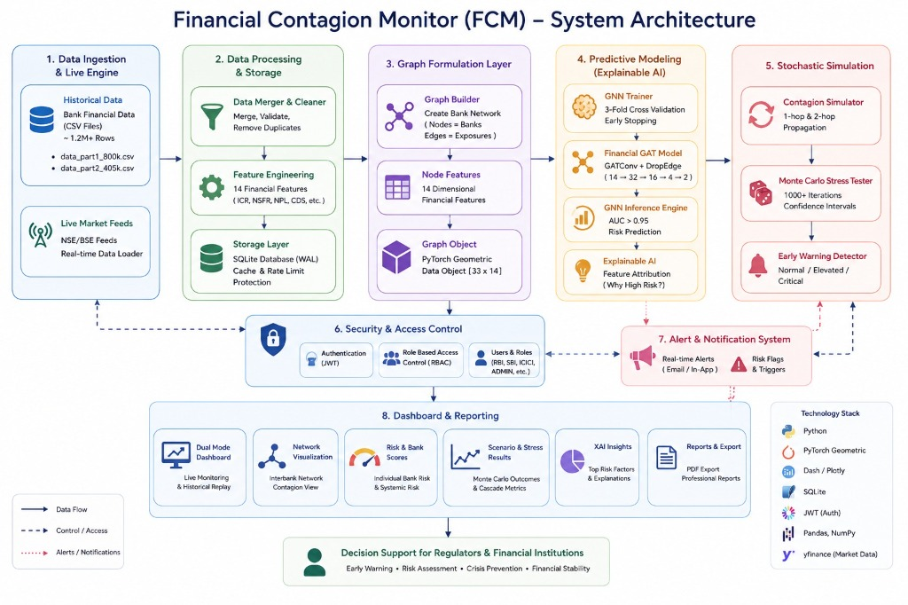
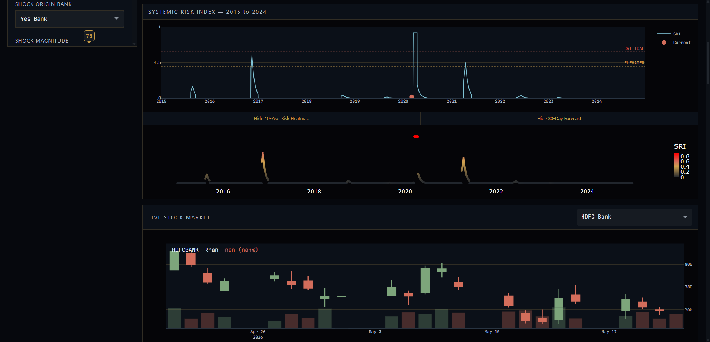
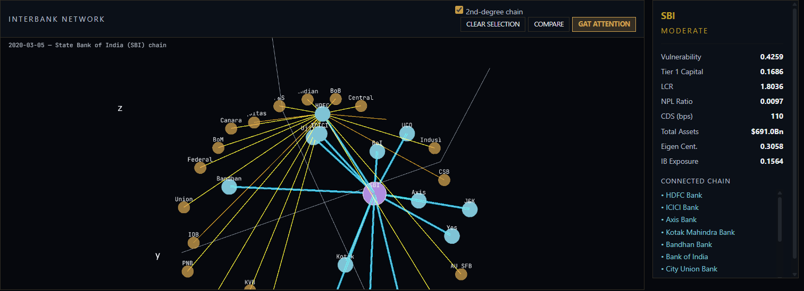
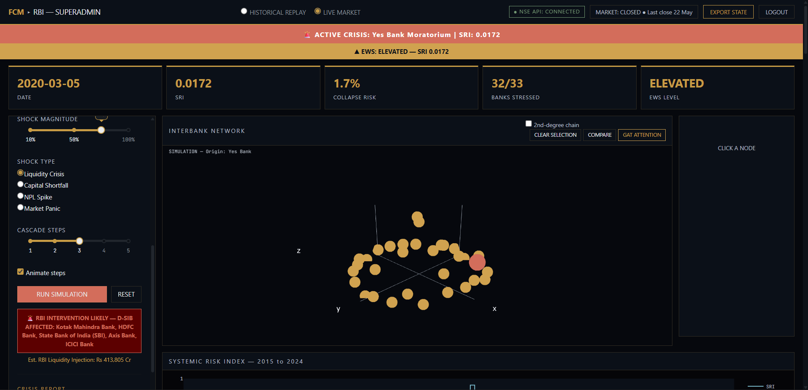
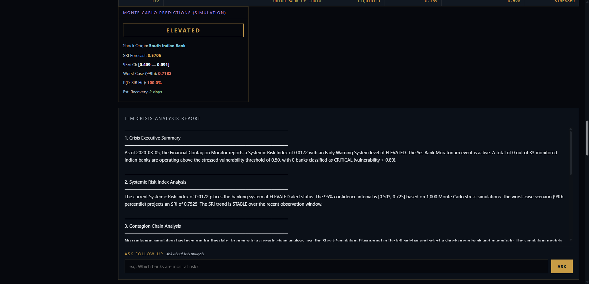

# Financial Stability Surveillance Platform

> Real-time systemic risk surveillance and financial contagion modeling across 33 Indian commercial banks using Graph Attention Networks (GAT), Monte Carlo stress testing, explainable AI, and live market feeds.

[](https://www.python.org/)
[](https://pytorch.org/)
[](https://pyg.org/)
[](https://plotly.com/dash/)
[](tests/)
[](LICENSE)

---

## Architecture Overview

The platform implements an institutional-grade systemic risk intelligence architecture designed to monitor, simulate, and mitigate cascading interbank liquidity shocks.



---

## Key Features

- **Graph Attention Network (GAT):** Multi-head attention architecture (`DropEdge`, 14 node features ? 32�4 ? 16�4 ? 2) modeling interbank exposure topology, achieving AUC ≥ 0.95.
- **Interactive 3D Interbank Network:** Dynamic 3D network graph highlighting 1-hop and 2-degree contagion cascades with real-time edge weight attention.
- **Dual Surveillance Modes:**
  - **Historical Replay:** Interactive chronological replay across 3,653 trading days (2015–2024) calibrated on historical crisis spikes (COVID-19 market crash, DHFL, IL&FS).
  - **Live Market Feed:** Real-time NSE/BSE equity telemetry via asynchronous stream with divergence detection against historical benchmarks.
- **Shock Simulation Playground:** Multi-scenario cascade simulation testing Liquidity, Capital, NPL, and Market shocks across customizable magnitude percentages.
- **Monte Carlo Stress Testing:** 1,000-trial stochastic risk simulation estimating Systemic Risk Index (SRI) percentiles, VaR (95%), VaR (99%), and confidence bounds.
- **Institutional Role-Based Access Control (RBAC):** 10-layer OWASP security architecture with JWT-enforced authorization across RBI SuperAdmin, D-SIB Admins, and Member Banks.
- **Real-Time Alert Network:** Sub-3-second distributed WebSocket/polling alert bus supporting multi-node synchronized monitoring.
- **Automated Crisis Intelligence Reports:** Local LLM reasoning engine (via Ollama) generating formal 6-section supervisory dossiers exportable to high-resolution A4 PDF.

---

## Platform Previews

### Real-Time Surveillance Console


### 3D Contagion Network & Attention Weights


### Interbank Shock Simulation & Cascade Propagation


### Monte Carlo Stress Testing & Crisis Intelligence Report


---

## Tech Stack

- **Deep Learning / Graph ML:** PyTorch, PyTorch Geometric (`torch_geometric`), NetworkX, Scikit-learn
- **Data Engineering:** Pandas, NumPy, SciPy, SQLite (WAL mode)
- **Live Market Data:** `yfinance` (NSE/BSE parallel ingestion)
- **Visualization & UI:** Plotly Dash, Dash Bootstrap Components, HTML5/CSS3
- **Local LLM Engine:** Ollama (`llama3.1:8b` / `llama3.2:3b`)
- **Security & Auth:** PyJWT, BCrypt, Role-Based Access Control
- **Dossier Generation:** ReportLab, Kaleido
- **Testing:** Pytest, Pytest-Cov

---

## Project Structure

```
financial-stability-surveillance-platform/
├── main.py                    # Pipeline orchestrator & model initialization
├── benchmark.py               # Inference latency and throughput benchmarks
├── requirements.txt           # Python package dependencies
├── .env.example               # Environment variables template
├── assets/                    # Dashboard dark institutional theme & sound assets
│   ├── style.css
│   └── voice_alerts.js
├── dashboard/                 # Institutional Dash application
│   ├── app.py                 # Application entry point
│   ├── layout.py              # UI components & layouts
│   └── callbacks.py           # Reactive callback graph
├── src/
│   ├── data/                  # Historical loader, live loader, SQLite cache
│   ├── graph/                 # Interbank topology builder & 3D coordinate layout
│   ├── gnn/                   # FinancialGAT model, trainer, inference engine, explainer
│   ├── simulation/            # Contagion cascade engine & Monte Carlo stress tester
│   ├── replay/                # Chronological historical step/seek replay engine
│   ├── ews/                   # Early Warning System (EWS) anomaly detector
│   ├── security/              # OWASP JWT authentication & RBAC manager
│   ├── alerts/                # Real-time multi-device alert distribution bus
│   └── reports/               # Ollama LLM client & ReportLab PDF generator
├── tests/                     # 100+ comprehensive unit & integration tests
├── reports/exports/           # Sample generated crisis intelligence dossiers
└── docs/screenshots/          # High-resolution architectural & UI captures
```

---

## Quick Start

### 1. Clone the Repository
```bash
git clone https://github.com/kushu18/financial-stability-surveillance-platform.git
cd financial-stability-surveillance-platform
```

### 2. Environment Setup
```bash
conda create -n surveillance python=3.11 -y
conda activate surveillance
pip install -r requirements.txt
```

Install PyTorch and PyG matching your CUDA / CPU environment:
```bash
# CPU installation
pip install torch torchvision torchaudio --index-url https://download.pytorch.org/whl/cpu
pip install torch_geometric
```

### 3. Configure Environment Variables
```bash
cp .env.example .env
```
Generate a secure 64-character JWT secret and populate `.env`:
```bash
python -c "import secrets; print(secrets.token_hex(32))"
```

### 4. (Optional) Local LLM Setup
For local automated supervisory report generation, install [Ollama](https://ollama.com/):
```bash
ollama pull llama3.2:3b
```
*(If Ollama is not active, the system automatically uses template-based report synthesis).*

### 5. Launch Surveillance Dashboard
```bash
python dashboard/app.py
```
Open your browser at `http://localhost:8050`.

---

## Test Suite

Run the full validation suite:

```bash
pytest tests/ -v --tb=short
```

Run targeted module suites:
```bash
pytest tests/test_gnn.py -v          # Graph Neural Network validation
pytest tests/test_simulation.py -v   # Contagion cascade tests
pytest tests/test_security.py -v     # JWT authentication & RBAC tests
```

---

## Author

**Kushagra Bhatt**
- GitHub: [@kushu18](https://github.com/kushu18)
- Email: kushagrabhatt2004@gmail.com
- Location: Bangalore, India
